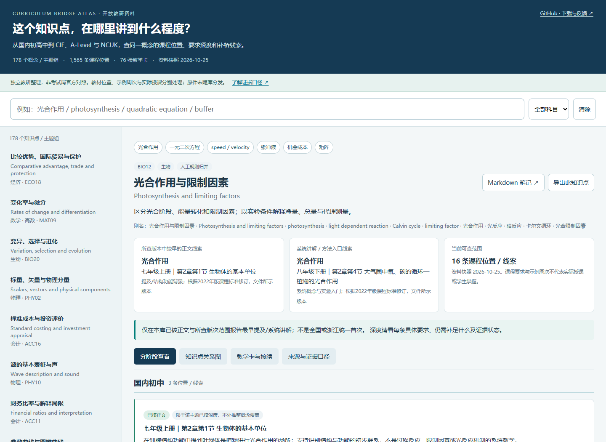

# Curriculum Bridge Atlas

**Where does the same concept appear across Chinese secondary curricula, Cambridge IGCSE / AS & A Level and NCUK IFY, and what still needs bridging?**

A Chinese-first, bilingual reference for subject teachers and curriculum coordinators: **178 concepts / topic groups, 1,565 curriculum locations, 123 bibliographic records, 76 original teaching cards, and a graph of 1,950 nodes / 4,082 directed edges**.

[Open the viewer](https://maxliu1979.github.io/curriculum-bridge-knowledge-graph/) · [Download an offline release](https://github.com/MaxLiu1979/curriculum-bridge-knowledge-graph/releases/latest) · [中文说明](README.md)



Subjects: economics, accounting, physics, chemistry, mathematics, further mathematics, biology and English. Selected teaching cards also discuss specific Pearson Edexcel, AQA and OxfordAQA course variants; these are not complete board-by-board mappings.

Search for `photosynthesis`, `quadratic equation`, `velocity`, `buffer`, `opportunity cost` or `matrix`. Compare stage-specific requirements, inspect source locators, explore a concept graph and choose original diagnostic or bridging activities. Teaching cards contain teacher answers.

## Use locally

Download and extract the release ZIP, then open `index.html`. Keep `web/` beside it. The viewer has no third-party JavaScript dependencies, analytics, account or upload feature. External source links and GitHub-hosted notes require internet access.

Open `vault/` as an existing Obsidian vault, starting from `Home.md`, for offline Markdown notes and subject Canvas files. Developers can use `data/atlas.json`, `exports/graph.json` and the node / edge CSV exports.

Optional command-line tools require Python 3.10+, standard library only:

```bash
python scripts/query.py "photosynthesis" --json
python scripts/build.py
python scripts/validate.py
```

## Interpret with care

The source snapshot is **25 October 2026**; the public edition was prepared on **2 November 2026**. The publication checks package structure and usability, not every curriculum claim anew.

- Relationships may express partial overlap, prerequisites or teaching-resource support. They do not establish complete curriculum equivalence.
- A textbook location, syllabus requirement or example teaching week does not establish actual teaching or learner mastery.
- Sequence and bridging proposals are editorial teaching suggestions. The earliest located evidence is limited to the editions examined.
- Third-party textbooks, syllabuses and restricted module documents are **not redistributed**. Bibliographic records, page locators and hashes help identify the relevant originals; official entry pages are not necessarily download links for those exact files.
- No classroom effectiveness claim or official endorsement is made. The project was prepared with AI assistance.

See [methodology](docs/METHODOLOGY.md), [sources](docs/SOURCES.md) and [contribution guidance](CONTRIBUTING.md). Please report errors with the concept ID, course code, edition and a publicly shareable locator; do not upload student information or restricted documents.

Software: [MIT](LICENSE). Original annotations, exercises and corresponding data: [CC BY 4.0](CONTENT_LICENSE.md). Third-party rights are unaffected. Maintained by **Max Liu**.
