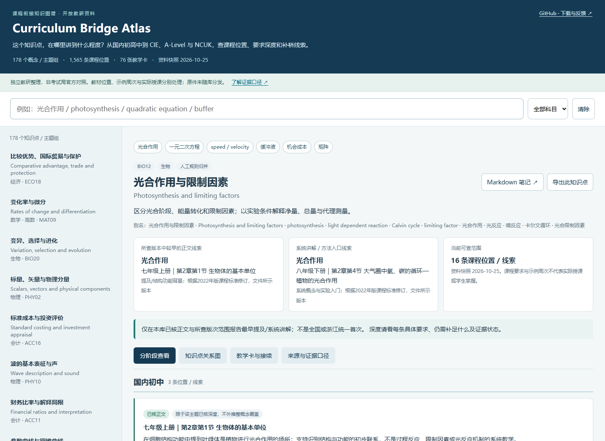

# Curriculum Bridge Atlas

课程衔接知识图谱

**同一个知识点，在国内初高中、CIE、A-Level 与 NCUK 中，分别讲到什么程度？转入后还需要补什么？**

这是面向学科教师和课程协调者的中英双语课程衔接资料库。用知识点组织教材位置、课程要求、证据状态和补桥练习，帮助备课时找到可核查的对照入口。

**[在线使用 →](https://maxliu1979.github.io/Curriculum-Bridge-Atlas/)** · **[下载离线包 →](https://github.com/MaxLiu1979/Curriculum-Bridge-Atlas/releases/latest)** · [English](README.en.md) · [报告问题](https://github.com/MaxLiu1979/Curriculum-Bridge-Atlas/issues)



## 可以怎样用

- 输入“光合作用 / photosynthesis”“一元二次方程 / quadratic equation”“缓冲液 / buffer”，查同一主题在不同阶段的位置和要求。
- 对照“可观察要求—当前线索—仍需补足”，选择诊断任务、补桥活动和迁移练习。
- 查看概念关系图、先修建议、课程代码、PDF 页码、版次注记和来源哈希。
- 下载 Obsidian 笔记或 JSON/CSV，接入自己的备课资料库和图谱工具。

## 当前范围

| 内容 | 数量 / 范围 |
| --- | --- |
| 学科入口 | 经济、会计、物理、化学、数学、高数、生物、英语 |
| 概念 / 主题组 | 178 |
| 课程位置与证据线索 | 1,565 |
| 来源书目 | 123 |
| 原创教学卡 | 76，含教师参考答案 |
| 图数据 | 1,950 个节点、4,082 条有向关系 |
| 主要阶段 | 国内初中、国内高中、CIE IGCSE、CIE AS/A-Level、CIE Further、NCUK IFY |
| 考试局接续 | 部分教学卡含 Pearson Edexcel、AQA、OxfordAQA 的具体课程变体对照 |

**资料快照为 2026-10-25，公开发布于 2026-11-02。** NCUK 主用材料以 2026–27 为主；旧版参考、课程差异和未确定信息保留在条目中。考试局分支存在于相关教学卡，不构成各考试局课程的完整图谱。

## 立即开始

1. **在线查看**：打开上方“在线使用”，输入中英文知识点，切换学科和视图。
2. **离线查看**：下载 Release 中的 `curriculum-bridge-atlas-v1.0.1.zip` 并解压，双击根目录 `index.html`。保留同目录的 `web/`。查看器无外部脚本依赖。
3. **Obsidian**：将解压后的 `vault/` 作为已有库打开，进入 `Home.md`，或打开学科 Canvas。也可用普通文本编辑器阅读全部 Markdown。
4. **开发者**：读取 `data/atlas.json` 或 `exports/graph.json`；图数据保留稳定 ID、关系类型与证据状态。

查看器在本机浏览器执行检索，无账号、分析脚本或数据上传功能。外部来源链接、GitHub 上的笔记页面仍需联网；在 Obsidian 中可离线浏览对应笔记。

需要命令行查询时，安装 Python 3.10+ 后运行，无第三方依赖：

```bash
python scripts/query.py "光合作用"
python scripts/query.py "quadratic equation" --json
python scripts/query.py "buffer" --subject 化学
```

## 证据口径

这里的连线表示“关联课程位置”“部分交集”“先修建议”或“教学资源支持”，并不自动表示课程等价。

- 教材章节、大纲要求、示例教学周次和实际授课属于不同信息；不能相互替代。
- “较早出现”限于已查版本和已有定位，不能外推为全国统一的首次教学时间。
- 先修、补桥顺序和转入判断属于教研建议；学生是否掌握仍需独立学习证据。
- “已核”沿用原资料快照的记录。本次发布检查了结构、引用和界面，没有重新逐页复核全部原件，也没有验证课堂效果。
- 76 张教学卡包含原创任务与教师参考答案，不能直接当作无答案学生练习册。

详见 [方法与数据说明](docs/METHODOLOGY.md) 和 [来源与公开范围](docs/SOURCES.md)。

## 仓库结构

| 位置 | 用途 |
| --- | --- |
| `index.html`、`web/` | 可离线使用的双语检索、阶段比较与关系图 |
| `data/atlas.json` | 公开版结构化概念、课程位置、来源和教学卡 |
| `exports/` | 图 JSON、节点 / 关系 CSV、来源 CSV |
| `vault/` | Obsidian / Markdown 知识库、学科 Canvas |
| `scripts/` | 离线检索、公开字段导出、重建与验证工具 |
| `docs/` | 方法、来源范围和预览图 |

修改公开数据后重新生成产物：

```bash
python scripts/build.py
python scripts/validate.py
node --check web/app.js
```

## 一起完善

欢迎通过 [Issue](https://github.com/MaxLiu1979/Curriculum-Bridge-Atlas/issues) 或 Pull Request 补充版本、修正页码、提出教学建议。请提供概念 ID、具体课程代码、年份 / 版本及可公开的定位依据；标清“原文要求”和“个人教研判断”。请勿提交教材整本、受限模块文件、学生姓名、成绩或课堂原始记录。详见 [贡献说明](CONTRIBUTING.md)。

本项目由 **Max Liu** 整理发布，AI 辅助形成初始资料与工具。它是独立教研项目，不代表 Cambridge、Pearson Edexcel、AQA、OxfordAQA、NCUK 或出版社的认证与背书。

软件代码采用 [MIT](LICENSE)；自行编写的注释、数据和原创练习采用 [CC BY 4.0](CONTENT_LICENSE.md)，欢迎注明来源后使用和改编。第三方课程材料不在这些许可的授权范围内，原件未随库分发。
